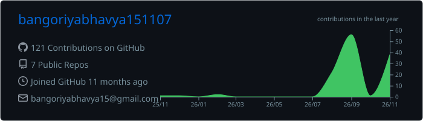
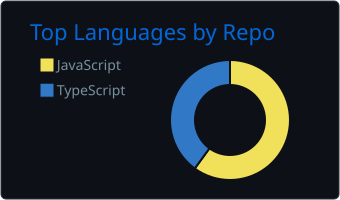
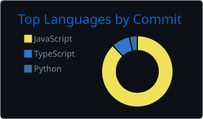
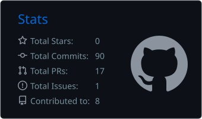
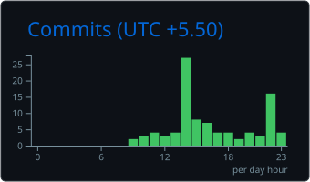
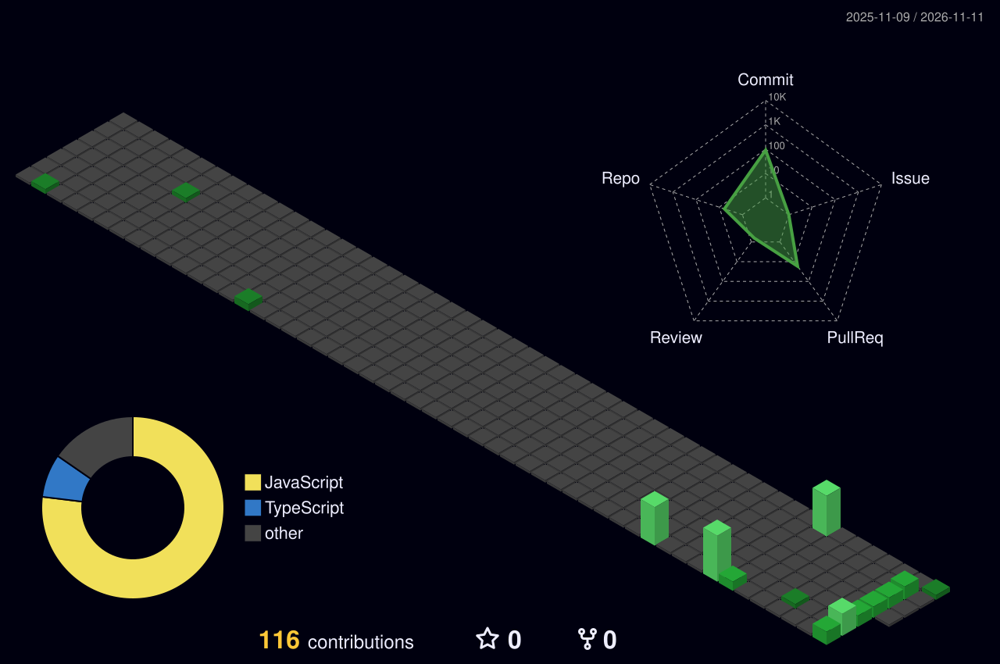

 

 

   

⚡ Systems Telemetry & Developer Profile
yaml
developer: "Bhavya Bangoriya (@bangoriyabhavya151107)"
education: "B.Tech in Computer Engineering @ DDU, Nadiad"
philosophy: "Offline-First, Self-Hosted Infra & Open-Source Tooling"
core_focus:
  - "Full-Stack & Motion UI (React, Next.js, Tailwind, GSAP, Supabase)"
  - "Local AI & Automation (Ollama, qwen2.5-coder, n8n, Docker)"
  - "Data Structures, Algorithms & Core Systems (C, C++, SQL)"
workstation: "VS Code + Docker Desktop + Local Supabase + Ollama"
🧰 Tech stack

  
 
     

📊 GitHub Metrics & Stats Dashboard
<!-- The first three blocks below are generated inside this repo by the workflow, so they always load. The last block (streak and readme-stats) comes from public servers that are sometimes busy; if those two look broken, it is the server, not this README. --> 
  
 
   
 
   
 
  
 
   

🌆 My year in 3D

  

🐍 Contribution snake

 <picture> <source media="(prefers-color-scheme: dark)" srcset="https://raw.githubusercontent.com/bangoriyabhavya151107/bangoriyabhavya151107/main/snake/snake-dark.svg" /> <source media="(prefers-color-scheme: light)" srcset="https://raw.githubusercontent.com/bangoriyabhavya151107/bangoriyabhavya151107/main/snake/snake.svg" />  </picture> 

🚀 Featured projects
Project	What it is	Built with
Pravas Saathi	A travel-planning app made for a hackathon. Discover places, build itineraries with stops and activities, and track trip expenses.	React, Vite, Supabase
ClubOps AI	From meeting to execution: plan, coordinate, execute. A team project for running club work.	JavaScript
Backspace	An offline-first typing trainer for developers, with CLI commands, code snippets, prompt drills and per-key latency analytics. Live at backspacedev.vercel.app.	React 19, TypeScript, Vite, Tailwind CSS v4

More on my repositories page.

 The dashboard, 3D graph and snake are regenerated every day by a GitHub Action in this repo. 

